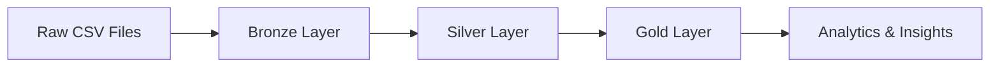

# ✈️ Global Airline Analytics Lakehouse

> SkyLedger Airline Analytics Project powered by Databricks, Delta Lake, and Unity Catalog.

<p align="center">
  
  
  
</p>

<svg width="100%" height="160" viewBox="0 0 760 160" xmlns="http://www.w3.org/2000/svg" role="img" aria-label="Animated airplane across the sky">
  <defs>
    <linearGradient id="sky" x1="0" x2="1">
      <stop offset="0%" stop-color="#e0f2fe"/>
      <stop offset="100%" stop-color="#f8fafc"/>
    </linearGradient>
  </defs>
  <rect width="760" height="160" rx="18" fill="url(#sky)"/>
  <g fill="#94a3b8" opacity="0.9">
    <text x="60" y="42" font-size="22">☁️</text>
    <text x="500" y="55" font-size="20">☁️</text>
    <text x="610" y="38" font-size="24">☁️</text>
  </g>
  <g>
    <text x="0" y="90" font-size="38">✈️</text>
    <animateTransform attributeName="transform" type="translate" values="0 0; 620 0; 0 0" dur="8s" repeatCount="indefinite"/>
  </g>
  <g fill="#0f172a" font-family="Segoe UI, Arial, sans-serif" font-size="14">
    <text x="18" y="130">Bronze</text>
    <text x="270" y="130">Silver</text>
    <text x="520" y="130">Gold</text>
  </g>
</svg>

## Overview
This project implements a modern airline analytics lakehouse using the TPC-A synthetic dataset. The goal is to transform raw flight and booking data into trusted, governed analytics-ready datasets.

## What this project does
- Ingests raw airline data into a Bronze layer
- Cleanses and validates records in Silver
- Enforces data quality and quarantine handling
- Builds curated Gold datasets for analysis
- Enables business reporting on revenue and operational trends

## Tech Stack
- Databricks
- Delta Lake
- Unity Catalog
- Apache Spark / PySpark
- SQL
- Medallion Architecture

## Architecture



## Business Questions Answered
- How much net booking revenue is generated?
- Which passengers, airlines, and routes contribute the most?
- How do booking trends change over time?
- Which regions and routes need deeper investigation?
- What can we learn through natural-language business analysis?

## Data Model Highlights
- Passenger master data
- Booking records
- Flight booking line items
- Route and airline dimension tables
- Geographic mapping with nation and region rollups

## Quality & Governance
- Primary key validation
- Numeric range checks
- Date validation
- Referential integrity checks
- Quarantine tables for rejected records
- Bronze-to-Silver reconciliation report

## Project Status
This project is completed and structured for a clean, end-to-end learning workflow using the Databricks Lakehouse approach.

## Example of the final pipeline concept

```text
Raw source CSVs
    ↓
Bronze tables
    ↓
Silver validation + quarantine
    ↓
Gold analytical datasets
    ↓
Insights / dashboards / reporting
```

## Notes
This is a synthetic airline analytics exercise using TPC-A benchmark-style sample data for practice and learning purposes.

---

<p align="center">
  <b>Built with ❤️ for airline data engineering and analytics.</b>
</p>
